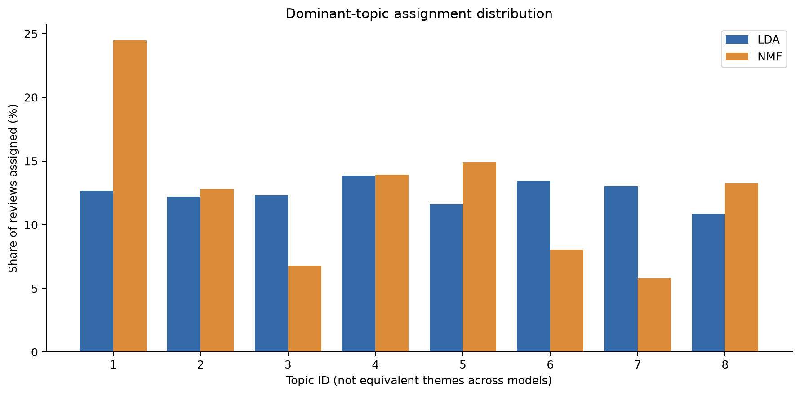
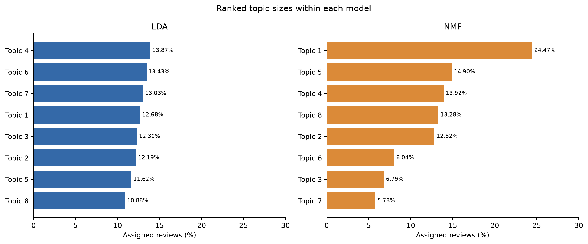
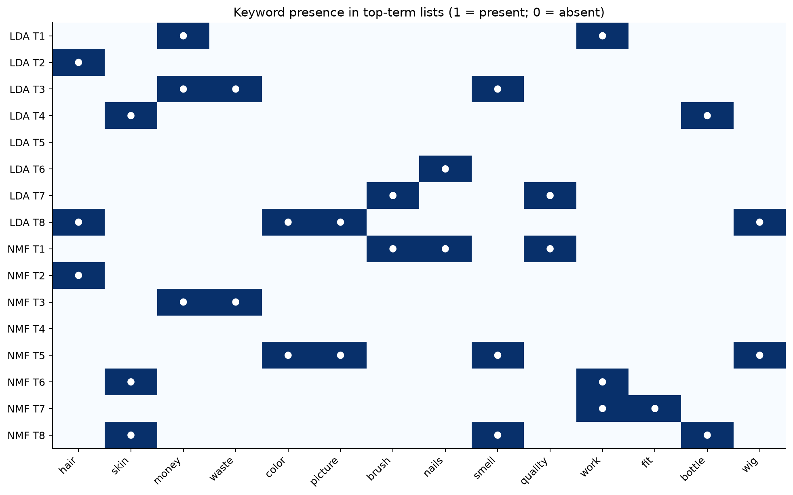
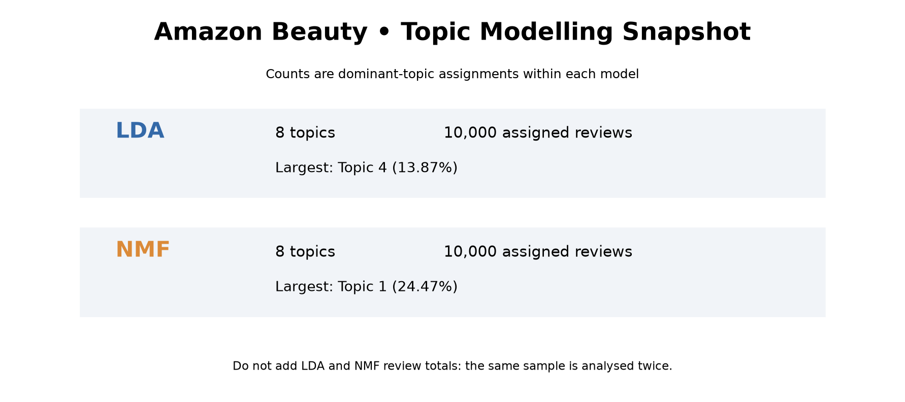

# Amazon Beauty Review Complaint Topic Modelling (IU Data Analysis)

## Objective
Discover recurring dissatisfaction themes in 1–2-star reviews from McAuley Lab's Amazon Reviews 2023 `All_Beauty` category.

## Data
Download `All_Beauty.jsonl` from https://amazon-reviews-2023.github.io/ and place it in the project directory. Do not commit the dataset or generated review text to a public repository.

## Reproduce
```bash
python -m venv .venv
# Activate the environment for your operating system
pip install -r requirements.txt
python analyze.py --input All_Beauty.jsonl --output results --sample 10000
```

The script filters 1–2-star reviews, requires >=10 whitespace-delimited words, deduplicates case-insensitive whitespace-normalized text, and samples with random seed 42. It creates CountVectorizer and TF-IDF matrices, fits 8-topic LDA and NMF models, and writes results/summary.json, results/topics.csv, results/sample_metadata.csv. `topics.csv` and `sample_metadata.csv` include review excerpts: do not publish these without checking dataset terms and privacy implications.

## Preliminary findings
The 10,000-review pilot produces some interpretable themes (hair products, appearance mismatch, nonfunctioning products, perceived wasted money, packaging/arrival issues), but some topics are generic or contaminated by HTML `br` tokens. Topic counts are dominant-topic assignments, not representative prevalence across all customers. Further cleaning, topic-number sensitivity tests, and manual document validation are needed before the final analysis.

## Methods and citations
- Hou, Y., Li, J., He, Z., Yan, A., Chen, X., & McAuley, J. (2024). *Bridging language and items for retrieval and recommendation*. https://doi.org/10.48550/arXiv.2403.03952
- Blei, D. M., Ng, A. Y., & Jordan, M. I. (2003). Latent Dirichlet allocation. *Journal of Machine Learning Research, 3*, 993–1022. https://www.jmlr.org/papers/v3/blei03a.html
- Scikit-learn developers. (n.d.). *Topic extraction with non-negative matrix factorization and latent Dirichlet allocation*. https://scikit-learn.org/stable/auto_examples/applications/plot_topics_extraction_with_nmf_lda.html
## Data Visualizations and Findings

This project includes four additional visualizations generated using Python and Matplotlib to support the interpretation of Latent Dirichlet Allocation (LDA) and Non-negative Matrix Factorization (NMF) topic modelling results.

### 1. Topic Distribution Comparison



This visualization compares the percentage of customer reviews assigned to each topic by the two models.

### 2. Ranked Topic Sizes



This chart ranks topics according to their assigned review counts, highlighting differences in topic concentration between LDA and NMF.

### 3. Topic Keyword Presence Heatmap



The heatmap shows the presence of selected keywords in the models' reported topic-term lists. It does not represent the frequency of those words across all reviews.

### 4. Project Statistics Dashboard



The dashboard summarizes the analysis of 10,000 sampled reviews, the eight topics extracted by each model, and the largest dominant-topic assignment percentages.

### Interpretation

Both models identified recurring themes of customer dissatisfaction, including product quality, effectiveness, appearance mismatch, and perceived value. LDA produced a relatively balanced distribution of dominant-topic assignments, whereas NMF produced a more concentrated distribution. Some topics overlapped, indicating that the extracted themes should be interpreted cautiously rather than treated as completely independent complaint categories.

### Reproducing the Visualizations

The visualization dashboard can be reproduced using the existing topic modelling results stored in `results/topics.csv`.

First, install the required Python dependencies:

```bash
pip install -r requirements.txt
```

Then execute the visualization script from the project's root directory:

```bash
python create_dashboard.py
```

The script automatically generates four PNG charts in the `results/charts/` directory. The original LDA and NMF models do not need to be retrained as long as `results/topics.csv` is available.